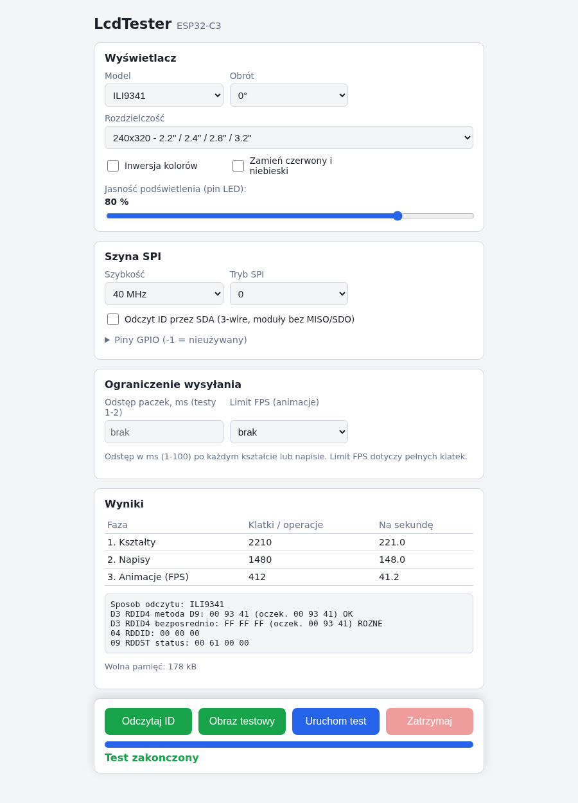
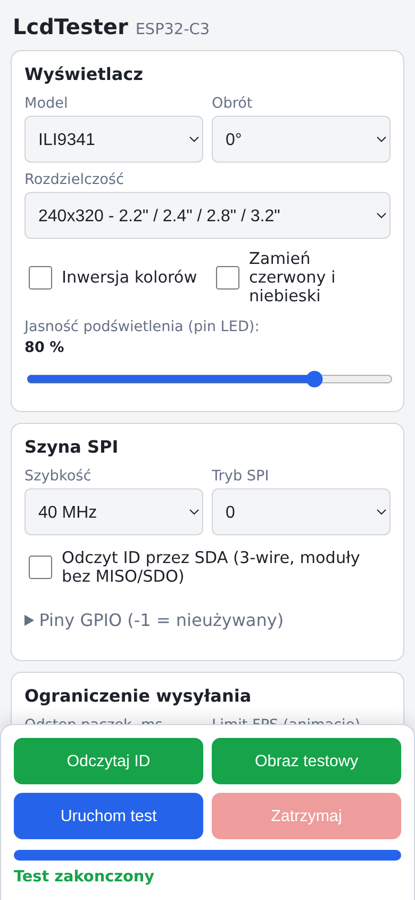

# LcdTester

Tester wyświetlaczy LCD SPI na ESP32 (domyślnie ESP32-C3), sterowany ze strony WWW.
Środowisko: VS Code + PlatformIO, framework Arduino, biblioteka LovyanGFX.

Program pozwala szybko sprawdzić nieznany moduł LCD: uruchomić go z wybranymi
parametrami, obejrzeć obraz testowy, zmierzyć wydajność przy różnych szybkościach SPI
i odczytać ID sterownika, żeby wykryć „podróbki” (np. moduł opisany jako ILI9341
z innym układem w środku).



---

## Część 1. Opis funkcjonalny

### Uruchomienie

1. Skopiuj `include/Secret.h.example` jako `include/Secret.h` i wpisz dane WiFi.
2. Skompiluj i wgraj: `pio run -t upload`, podgląd logów: `pio device monitor`.
3. Otwórz `http://lcdtester.local` albo adres IP wypisany w monitorze portu.

Gdy sieć WiFi jest niedostępna (albo `WIFI_SSID` jest pusty), ESP tworzy własną sieć
`AP_SSID` (domyślnie `LcdTester`), a panel jest pod `http://192.168.4.1`.
Puste `WIFI_PASSWORD` oznacza łączenie z siecią otwartą, a puste `AP_PASSWORD`
punkt dostępowy bez hasła. Hasło AP o długości 1–7 znaków zatrzymuje kompilację.

### Panel WWW

Strona działa na komputerze i na telefonie. Przyciski i pasek postępu są w panelu
przyklejonym do dołu ekranu, więc zawsze są pod ręką. Ustawienia zapamiętują się
w przeglądarce.



*Zrzuty pokazują stronę z konfiguracją pobraną z urządzenia i przykładowymi wynikami.*

#### Sekcja „Wyświetlacz”

| Ustawienie | Opis |
|---|---|
| **Model** | Sterownik wyświetlacza: ILI9341, ST7789, ST7735, ILI9488, GC9A01A. |
| **Obrót** | 0°, 90°, 180°, 270°. |
| **Rozdzielczość** | Lista zależna od modelu, z opisem przekątnej i wariantu modułu. Każda pozycja ma wpisane przesunięcie obszaru w pamięci sterownika. |
| **Inwersja kolorów** | Odwraca kolory. Większość ST7789, GC9A01A i ekrany 0.96" ST7735 jej wymagają; ustawiana domyślnie wg modelu. |
| **Zamień czerwony i niebieski** | Gdy w fazie 1 napis RED jest na niebieskim tle. Domyślnie wyłączone = kolory tak, jak ustawia je LovyanGFX. |
| **Jasność podświetlenia** | Suwak 0–100 %, sygnał PWM na pinie LED. Działa od razu, także w trakcie testu. 100 % = pełny, stały stan wysoki. |

#### Sekcja „Szyna SPI”

| Ustawienie | Opis |
|---|---|
| **Szybkość** | 1, 5, 10, 20, 26.7, 40, 80 MHz. Po każdej zmianie modelu ustawia się jego **domyślna** (bezpieczna) częstotliwość, oznaczona na liście „(domyślna)”. Częstotliwości powyżej zalecanego maksimum są oznaczone „(ponad zalecaną)”. Na długich przewodach zacznij od 10 MHz. |
| **Tryb SPI** | 0–3 (CPOL/CPHA). Zwykle 0. Tryb 3 pomaga przy modułach ST7789 240x240 bez pinu CS. |
| **Odczyt ID przez SDA (3-wire)** | Dla modułów bez wyjścia SDO/MISO - sterownik odpowiada tą samą linią SDA. Dotyczy tylko odczytu ID. |
| **Piny GPIO** | Rozwijana lista: SCLK, MOSI, MISO, CS, DC, RST, LED, z nazwami spotykanymi na modułach. Wartość -1 = niepodłączony. Pod listą widać domyślne piny z firmware i link „Przywróć domyślne”. Piny pamięci flash (np. GPIO 11–17 w C3) są odrzucane. |

#### Sekcja „Ograniczenie wysyłania”

Służy do sprawdzenia, czy problemy z obrazem wynikają z transmisji, czy z odświeżania
matrycy przez sterownik (tearing).

| Ustawienie | Opis |
|---|---|
| **Odstęp paczek, ms (testy 1-2)** | Puste = brak, 1–100 ms przerwy po każdym kształcie lub napisie. |
| **Limit FPS (animacje)** | Brak / 30 / 10 / 5 / 1 pełnych klatek na sekundę w fazie 3. |

#### Przyciski

| Przycisk | Działanie |
|---|---|
| **Odczytaj ID** | Odczyt identyfikatora sterownika sposobem właściwym dla wybranego modelu, bez inicjalizacji ekranu (patrz niżej). |
| **Obraz testowy** | Start wyświetlacza i jeden statyczny obraz: paski kolorów, gradienty R/G/B/szary, siatka, koło z krzyżem (kontrola proporcji), ramka 1 px i kolorowe narożniki (kontrola przesunięcia), podpis z parametrami. Obraz idzie jednym przesłaniem, gdy starczy RAM na bufor całego ekranu. |
| **Uruchom test** | Pełny test 3 × 10 s. |
| **Zatrzymaj** | Przerywa test od razu. |

#### Pełny test

1. **Kształty** – pełne kolory z podpisami (kontrola inwersji i kolejności R/B), gradienty,
   potem losowe kwadraty, koła i trójkąty.
2. **Napisy** – napisy w narożnikach i na środku (kontrola krawędzi), potem losowe napisy
   różnymi czcionkami, rozmiarami i kolorami.
3. **Animacje** – odbijające się kule i „plazma” na pełnym ekranie, z pomiarem FPS.

Po teście na wyświetlaczu zostaje ekran z wynikami. Wyniki (operacje/s, FPS) są też
w sekcji „Wyniki” na stronie i w monitorze portu.

#### Odczyt ID

Każdy model ma własny sposób odczytu (rejestry, takty „dummy”, metoda D9 dla ILI934x)
i oczekiwany kod, np. ILI9341 `D3` = `00 93 41`, ST7789 `04` = `85 85 52`.
Odczyt jest programowy (bit-bang, ok. 100 kHz), niezależny od LovyanGFX. Wymaga pinu MISO
albo opcji 3-wire. Wynik:

- **Zgodny z …** – ID się zgadza (zaznaczane też, gdy zgadza się po przesunięciu o 1 bit,
  co zdarza się w klonach),
- **NIEZGODNY z … – prawdopodobnie …** – sterownik odpowiada, ale to inny układ,
- **Brak odpowiedzi (same 00 / FF)** – brak komunikacji, sprawdź przewody.

Szczegóły każdego rejestru (odczytane i oczekiwane bajty) są w sekcji „Wyniki”.

### Domyślne piny ESP32-C3

| SCLK | MOSI | MISO | CS | DC | RST | LED |
|---|---|---|---|---|---|---|
| 6 | 7 | 2 | 10 | 3 | 1 | 4 |

SCLK, MOSI, MISO i CS to natywne piny SPI2 (IO MUX), co pomaga przy wysokich
częstotliwościach. Do tego zasilanie 3V3 i GND.

---

## Część 2. Kod źródłowy

Kod ma budowę modułową; każdy plik `.h` jest opisany w formacie Doxygen
(po polsku). Dokumentację HTML generuje polecenie `doxygen` w katalogu projektu
(wynik w `docs/html/index.html`).

| Plik | Zawartość |
|---|---|
| `src/main.cpp` | Punkt wejścia: tworzy obiekty WiFi, testów i serwera WWW. |
| `src/BoardPins.h` | Struktura `LcdPins` i domyślne piny dla ESP32-C3 / S3 / ESP32. |
| `src/LcdModels.h/.cpp` | **Spis obsługiwanych LCD**: modele, rozdzielczości, przesunięcia, ustawienia domyślne, kroki odczytu ID, lista częstotliwości SPI. |
| `src/LcdDevice.h/.cpp` | `LcdTestConfig` (parametry testu) i `LcdDevice` – wyświetlacz LovyanGFX konfigurowany w czasie działania. |
| `src/LcdTests.h/.cpp` | Fazy testu, obraz testowy, ekran startowy i końcowy, bufory animacji. |
| `src/TestRunner.h/.cpp` | Uruchamianie testu w osobnym zadaniu FreeRTOS, walidacja parametrów, stan i wyniki. |
| `src/LcdIdReader.h/.cpp` | Programowy odczyt ID sterownika i porównanie z modelem. |
| `src/Backlight.h/.cpp` | Podświetlenie – PWM na pinie LED. |
| `src/WifiConnection.h/.cpp` | WiFi, zapasowy punkt dostępowy, mDNS. |
| `src/WebServerApp.h/.cpp` | Serwer WWW i API JSON. |
| `src/web/IndexHtml.h` | Strona panelu (HTML/CSS/JS w PROGMEM). |
| `include/Secret.h` | Dane WiFi (w `.gitignore`; wzór w `Secret.h.example`). |

### Jak to działa

```
przeglądarka ──HTTP──> WebServerApp ──LcdTestConfig──> TestRunner (zadanie FreeRTOS)
                                                        ├─ LcdDevice + LcdTests  (LovyanGFX)
                                                        ├─ LcdIdReader           (bit-bang)
                                                        └─ Backlight             (PWM)
```

- `WebServerApp` zamienia parametry z formularza na `LcdTestConfig` i woła `TestRunner::start()`.
- `TestRunner` tworzy `LcdDevice` na czas jednego testu. Destruktor zwalnia szynę SPI,
  więc kolejny test może mieć inny model, piny i szybkość bez restartu ESP.
- Animacje rysują ekran pasami w dwóch buforach na zmianę: w jednym program rysuje,
  drugi w tym czasie leci przez DMA (inaczej powstają artefakty z poprzedniej klatki).
- Strona co 0,5 s pyta `/api/status` o postęp i wyniki.

### API

| Metoda | Adres | Działanie |
|---|---|---|
| GET | `/` | strona panelu |
| GET | `/api/config` | modele, rozdzielczości, częstotliwości, domyślne piny |
| POST | `/api/start` | pełny test |
| POST | `/api/pattern` | obraz testowy |
| POST | `/api/readid` | odczyt ID |
| POST | `/api/stop` | przerwanie testu |
| GET | `/api/status` | stan, wyniki, komunikat, wolna pamięć, jasność |
| POST | `/api/brightness?value=0..100` | jasność podświetlenia |

Parametry `start` / `pattern` / `readid`: `model`, `res`, `rot`, `freq`, `mode`, `invert`,
`swaprb`, `spi3wire`, `brightness`, `delay`, `fps`, `sclk`, `mosi`, `miso`, `cs`, `dc`, `rst`, `led`.

### Konfiguracja PlatformIO

- Środowisko `esp32c3` (płytka `esp32-c3-devkitm-1`); zakomentowane środowiska dla ESP32 i ESP32-S3.
- Partycja `huge_app.csv` – 3 MB na aplikację, bez OTA.
- Biblioteka `lovyan03/LovyanGFX`.

---

## Część 3. Dodawanie kolejnych wyświetlaczy

**Spis wyświetlaczy jest w `src/LcdModels.cpp`** (tablica `LCD_MODELS`), a typy opisujące
model – w `src/LcdModels.h`. Strona WWW pobiera listę z `/api/config`, więc nowy model
pojawia się na niej sam, bez zmian w HTML.

Obecny spis:

| Model | Rozdzielczości | Domyślna SPI | Maks. zalecana SPI | Inwersja | Oczekiwane ID |
|---|---|---|---|---|---|
| ILI9341 | 240x320 | 40 MHz | 40 MHz | nie | `D3` = 00 93 41 |
| ST7789 | 240x320, 240x240, 240x280, 170x320, 172x320, 135x240 | 40 MHz | 80 MHz | tak | `04` = 85 85 52 |
| ST7735 | 128x160 (2 warianty), 128x128, 80x160 | 20 MHz | 26.7 MHz | nie | `04` = 7C 89 F0 |
| ILI9488 | 320x480 | 20 MHz | 40 MHz | nie | `D3` = 00 94 88 |
| GC9A01A | 240x240 (okrągły) | 40 MHz | 80 MHz | tak | `04` = 00 9A 01 |

Domyślna częstotliwość (`defaultFreqHz`) to bezpieczna wartość ustawiana na stronie
po wyborze modelu; maksymalna (`maxFreqHz`) służy tylko do oznaczenia szybszych pozycji na liście.

### Nowa rozdzielczość istniejącego modelu

Wystarczy dopisać wiersz do tablicy rozdzielczości modelu, np. dla ST7789:

```cpp
static const LcdResolution ST7789_RES[] = {
  // szer., wys., przesunięcie X, Y, opis
  { 240, 320,  0,  0, "2.0\" / 2.4\"" },
  { 240, 240,  0, 80, "1.3\" (wariant z przesunieciem Y)" },  // nowa pozycja
};
```

Przesunięcie to miejsce, w którym widoczny obszar zaczyna się w pamięci sterownika
(pamięć bywa większa od matrycy). Ramka i narożniki obrazu testowego pokazują, czy jest dobre.

### Nowy model

Przykład dla sterownika `ST7796` (320x480, 3.5"/4.0"), którego jeszcze nie ma w spisie.
Tak samo został dodany GC9A01A – można podejrzeć jego wpisy w kodzie.

1. **`src/LcdModels.h`** – dodaj sterownik do `LcdDriver`:
   ```cpp
   enum class LcdDriver : uint8_t {
     ILI9341, ST7789, ST7735, ILI9488, GC9A01A,
     ST7796,   ///< ST7796, 320x480.
   };
   ```

2. **`src/LcdDevice.h` i `.cpp`** – dodaj panel LovyanGFX i wybierz go w konstruktorze
   (lista paneli: katalog `lgfx/v1/panel` biblioteki):
   ```cpp
   // LcdDevice.h
   lgfx::Panel_ST7796 _panelSt7796;  ///< Panel dla LcdDriver::ST7796.
   // LcdDevice.cpp, switch w konstruktorze
   case LcdDriver::ST7796: _panel = &_panelSt7796; break;
   ```

3. **`src/LcdModels.cpp`** – dopisz rozdzielczości, kroki odczytu ID i wpis do `LCD_MODELS`:
   ```cpp
   static const LcdResolution ST7796_RES[] = {
     { 320, 480, 0, 0, "3.5\" / 4.0\"" },
   };

   // Kroki odczytu ID wg dokumentacji sterownika
   static const LcdIdStep ST7796_ID[] = {
     // komenda, bajty, takty dummy, metoda, nazwa, sprawdzać?, oczekiwane
     { 0xD3, 3, 8, IdReadMethod::Direct, "RDID4", true, { 0x00, 0x77, 0x96 } },
   };

   const LcdModel LCD_MODELS[] = {
     ...
     // id, nazwa, sterownik, inwersja, zamiana R/B,
     // domyślna SPI Hz, maks. SPI Hz, pamięć szer., wys.
     { "st7796", "ST7796", LcdDriver::ST7796, false, false, 20000000, 40000000, 320, 480,
       ST7796_RES, COUNT(ST7796_RES), ST7796_ID, COUNT(ST7796_ID) },
   };
   ```

4. Opcjonalnie w `src/LcdIdReader.cpp` dopisz charakterystyczną parę bajtów do `SIGNATURES` –
   wtedy odczyt ID innego modelu podpowie „prawdopodobnie ST7796” (dla ST7796 już jest).

5. Skompiluj (`pio run`), wgraj i sprawdź: **Obraz testowy** (kolory, ramka, narożniki),
   **Odczytaj ID** i pełny test.

Pola `LcdModel` i `LcdIdStep` są szczegółowo opisane w komentarzach Doxygen w `src/LcdModels.h`.

### Inna wersja ESP32

W `platformio.ini` odkomentuj środowisko (`esp32dev` lub `esp32s3`), a domyślne piny
ustaw w `src/BoardPins.h` w sekcji dla danego układu.
